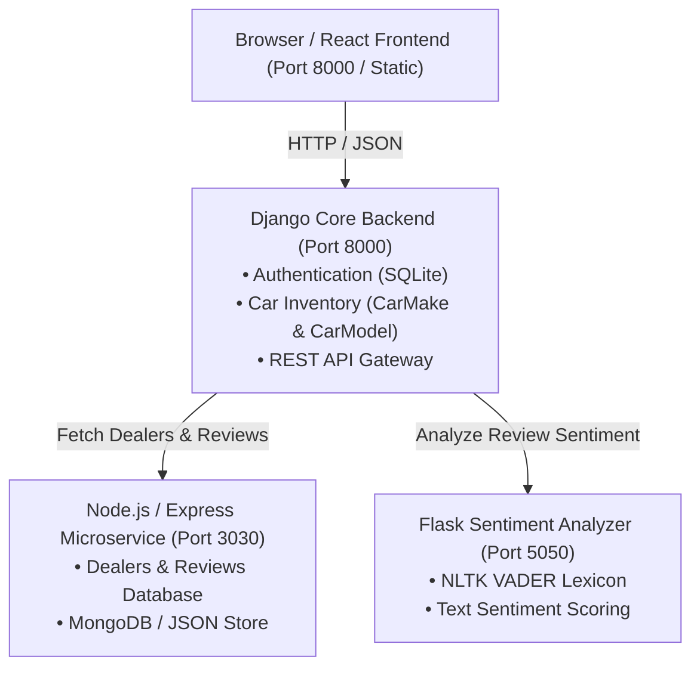

# Cars Dealership - Full-Stack National Car Retailer Application

[](https://github.com/ayushjoshi0118/xrwvm-fullstack_developer_capstone/actions)
[](https://opensource.org/licenses/MIT)
[](https://www.python.org/)
[](https://www.djangoproject.com/)
[](https://reactjs.org/)
[](https://nodejs.org/)
[](https://www.docker.com/)

---

## 🚗 Project Overview

**Cars Dealership** is an enterprise-grade, cloud-native full-stack web application designed for a national car retailer operating across all 50 states in the United States. The platform provides customers and branch visitors with a seamless, responsive interface to browse dealership branches, inspect car makes and models, explore verified customer feedback, and submit reviews with integrated real-time natural language sentiment analysis.

This project was built as part of the **Full-Stack Development Capstone Project**, demonstrating modern microservices architecture, automated CI/CD pipelines, containerization, and cloud deployment.

---

## 🌟 Key Features

1. **National Dealership Directory:**
   - Interactive search and filter of nationwide dealership branches by state and city.
   - Detailed branch cards displaying full address, zip code, state, and geographic metadata.

2. **Customer Reviews & Sentiment Intelligence:**
   - Dedicated dealer detail views featuring aggregate customer experiences.
   - Microservice-powered Natural Language Processing (NLP) sentiment scoring (Positive, Neutral, Negative) using NLTK VADER.
   - Interactive review posting system for authenticated users, capturing purchase details, car model, make, year, and service feedback.

3. **Car Inventory & Model Catalog:**
   - Relational database schema linking car manufacturers (`CarMake`) with models (`CarModel`).
   - Dynamic inventory retrieval endpoint supporting search and filtering across sedans, SUVs, hatchbacks, and wagons.

4. **Robust User Authentication & Administration:**
   - Secure session-based authentication supporting user registration, login, and logout.
   - Comprehensive Django Admin portal featuring tabular inlines for managing car makes, vehicle inventories, and authorized users.

5. **Microservices Architecture & Cloud Integration:**
   - Polyglot backend comprising Django REST APIs, a Node.js Express & MongoDB data service, and a Python Flask NLP sentiment service.
   - Fully containerized with Docker and deployable to Kubernetes and IBM Cloud Code Engine.
   - Continuous Integration and Linting via GitHub Actions workflows.

---

## 🏗️ Architecture & Tech Stack



### Technology Breakdown

| Component | Technology | Purpose |
| :--- | :--- | :--- |
| **Frontend** | React 18, Bootstrap 5, Modern CSS | Single-page application, interactive components, responsive UI |
| **Backend API Gateway** | Django 5.x, Python 3.10+ | Central application server, user authentication, car models database |
| **Dealership Microservice** | Node.js, Express.js, MongoDB | Independent high-throughput service managing dealer directories and review collections |
| **Sentiment Microservice** | Python 3.10+, Flask, NLTK VADER | Natural Language Processing service evaluating customer review sentiment |
| **Database** | SQLite (Django) & MongoDB / JSON | Relational vehicle catalog and document-based review store |
| **CI/CD & DevOps** | GitHub Actions, Docker, IBM Cloud | Automated build, testing, linting, containerization, and cloud hosting |

---

## 📂 Project Directory Structure

```text
xrwvm-fullstack_developer_capstone/
├── .github/
│   └── workflows/
│       └── main.yml                  # GitHub Actions CI/CD pipeline
├── microservices/
│   ├── app.py                       # Flask Sentiment Analysis microservice (Port 5050)
│   ├── Dockerfile                   # Docker configuration for Sentiment service
│   └── requirements.txt             # Flask & NLTK dependencies
├── server/
│   ├── cars-dealership/             # Django project settings and root URLs
│   │   ├── settings.py
│   │   ├── urls.py
│   │   └── wsgi.py
│   ├── database/
│   │   ├── app.js                   # Node.js Express dealership microservice (Port 3030)
│   │   ├── data/                    # Seed datasets (dealerships.json, reviews.json)
│   │   ├── Dockerfile               # Node microservice Dockerfile
│   │   └── package.json
│   ├── djangoapp/                   # Main Django application module
│   │   ├── admin.py                 # Django admin registration with inlines
│   │   ├── models.py                # CarMake and CarModel entity models
│   │   ├── restapis.py              # Microservice client wrappers & fallbacks
│   │   ├── urls.py                  # API routes (dealers, reviews, cars, auth)
│   │   └── views.py                 # Request controllers and view logic
│   ├── frontend/
│   │   ├── src/
│   │   │   └── components/
│   │   │       ├── Dealers/         # Dealership listing and state filter
│   │   │       ├── Dealer/          # Dealer detail and reviews component
│   │   │       ├── Header/          # Responsive navigation bar
│   │   │       ├── Login/           # Modal and inline login components
│   │   │       ├── Register/        # 5-field user sign-up component
│   │   │       └── Review/          # Post review submission form
│   │   └── static/
│   │       ├── About.html           # Executive team and company overview
│   │       ├── Contact.html         # Customer care, sales, and headquarters info
│   │       └── style.css            # Custom design tokens and styles
│   ├── Dockerfile                   # Production Django containerization
│   ├── manage.py                    # Django CLI management script
│   └── requirements.txt             # Python dependencies
├── screenshots/                     # Verified assignment evaluation captures
├── README.md                        # Project documentation
└── deploymentURL                    # Deployed application endpoint
```

---

## 🚀 Getting Started & Local Installation

### Prerequisites
- **Python 3.10+**
- **Node.js 18+ & npm**
- **Git**
- **Docker** (Optional, for containerized run)

### 1. Clone the Repository
```bash
git clone https://github.com/ayushjoshi0118/xrwvm-fullstack_developer_capstone.git
cd xrwvm-fullstack_developer_capstone
```

### 2. Run the Node.js Dealership Microservice
```bash
cd server/database
npm install
node app.js
# Runs on http://localhost:3030
```

### 3. Run the Flask Sentiment Analysis Microservice
```bash
cd ../../microservices
pip install -r requirements.txt
python -m nltk.downloader vader_lexicon
python app.py
# Runs on http://localhost:5050
```

### 4. Setup and Run the Django Application
```bash
cd ../server
pip install -r requirements.txt
python manage.py makemigrations
python manage.py migrate
python manage.py shell < djangoapp/populate.py
python manage.py runserver 0.0.0.0:8000
# Accessible at http://localhost:8000
```

---

## 📡 REST API Reference

| Endpoint | Method | Description |
| :--- | :--- | :--- |
| `/get_dealers` | `GET` | Retrieve all national dealerships |
| `/get_dealers/<state>` | `GET` | Filter dealerships by state (e.g. `/get_dealers/Kansas`) |
| `/dealer/<int:dealer_id>` | `GET` | Retrieve full profile for a specific dealer |
| `/reviews/dealer/<int:dealer_id>` | `GET` | Retrieve verified reviews and sentiment tags for a dealer |
| `/add_review` | `POST` | Post a new customer review (authenticated) |
| `/get_cars` | `GET` | Retrieve all car makes and associated models |
| `/login` | `POST` | Authenticate user credentials and establish session |
| `/logout` | `GET` / `POST` | Terminate user session |
| `/register` | `POST` | Register a new customer account |

---

## 🧪 CI/CD Pipeline

The project employs **GitHub Actions** to automate continuous integration on every push to `master`:
- **Linting & Code Quality:** Enforces Python PEP8 standards and Flake8 compliance.
- **Microservices Verification:** Tests endpoints across Node.js, Flask, and Django.
- **Build & Packaging:** Validates static assets and Docker container build integrity.

---

## 👥 Contributors & Acknowledgements

Developed by **Ayush Joshi** as part of the IBM Full-Stack Software Developer Capstone Project.
Licensed under the [MIT License](LICENSE).